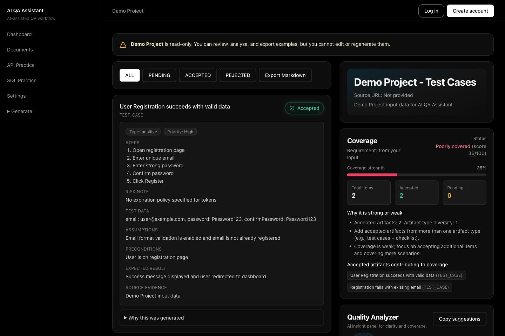
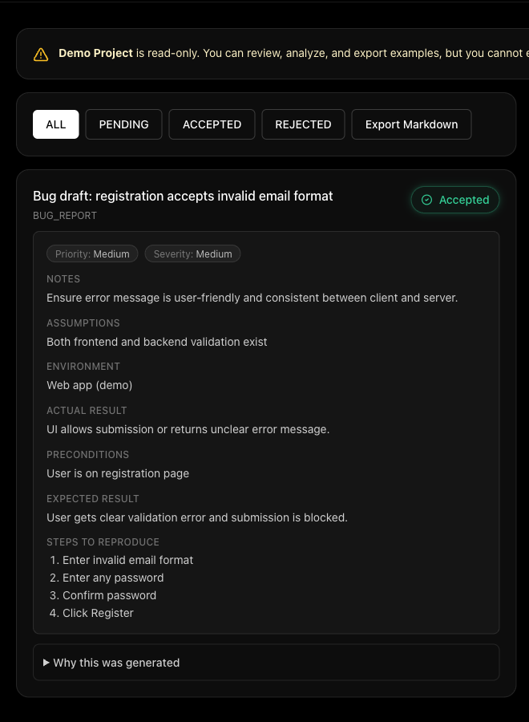
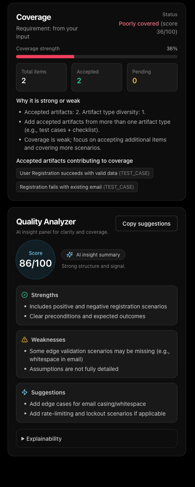

<div align="center">



# AI QA Assistant

**Turns requirements into test cases, checklists, bug-report drafts and API test ideas, and makes a person review every item before it can be exported.**

[](https://github.com/Bogdusik/AI-QA-Assistant/actions/workflows/ci.yml)
[](https://ai-qa-assistant-lyart.vercel.app/demo/test-cases)


[](LICENSE)

</div>

## Try the demo

A read-only Demo Project opens without an account:
[test cases](https://ai-qa-assistant-lyart.vercel.app/demo/test-cases) ·
[checklist](https://ai-qa-assistant-lyart.vercel.app/demo/checklist) ·
[bug report](https://ai-qa-assistant-lyart.vercel.app/demo/bug-report) ·
[API test ideas](https://ai-qa-assistant-lyart.vercel.app/demo/api-ideas).

<table>
<tr>
<td width="58%" valign="top">
<br>
<b>Every artifact type, readable.</b> A bug-report draft with severity, environment, actual and expected result and steps to reproduce.
</td>
<td width="42%" valign="top">
<br>
<b>Coverage and quality.</b> What the accepted items cover, why the score is what it is, and what to add next.
</td>
</tr>
</table>

## What it does

- **Human in the loop:** every generated item starts as `PENDING` and has to be `ACCEPTED` or `REJECTED`; exports include accepted items only (Markdown, CSV or plain text depending on the type).
- **Coverage and Quality Analyzer:** a score with strengths, weaknesses and suggestions, plus the reasoning behind it, stored in PostgreSQL.
- **Improve with AI:** ask for a better version of an item and compare old and new before applying it.
- **Traceability:** each item carries its evidence, assumptions and risk notes.
- **Guest mode:** try the generators without an account, with usage limits; a guest stays on the first generator type they choose.

## Tech Stack

- Frontend: Next.js 15 (App Router), React, TypeScript, Tailwind CSS
- Backend: Next.js Route Handlers + Zod validation
- Database: PostgreSQL + Prisma ORM (migrations + seed)
- Auth: NextAuth Credentials provider + guest sessions
- AI: OpenAI API (centralized in `lib/ai/service.ts`)

## How to Run Locally

### 1) Clone the repository

```bash
git clone https://github.com/Bogdusik/AI-QA-Assistant.git
cd AI-QA-Assistant
```

### 2) Install dependencies

```bash
npm ci
```

### 3) Configure environment variables

Create your local env file:

```bash
cp .env.example .env
```

Then update `.env` with your own PostgreSQL + OpenAI credentials.

### 4) Set up the database (Prisma)

Generate Prisma client:

```bash
npm run prisma:generate
```

Run migrations (development):

```bash
npm run prisma:migrate
```

Seed demo data:

```bash
npm run prisma:seed
```

### 5) Start the app

```bash
npm run dev
```

Open:

- App: http://localhost:3000
- Demo: http://localhost:3000/demo

Important: Never hardcode secrets. Do not commit `.env` to GitHub.

## Deploying to Vercel

### 1) Connect the repo

In Vercel: GitHub → select `Bogdusik/AI-QA-Assistant` → branch `main`.

### 2) Add Environment Variables

Set the same values as in your `.env` (without committing them), specifically:

- `DATABASE_URL`
- `OPENAI_API_KEY`
- `AUTH_SECRET`
- `NEXTAUTH_URL`
- `UPLOAD_DIR`
- `GUEST_USAGE_LIMIT`

### 3) Vercel build commands

Recommended settings:

- **Install Command**: `npm ci`
- **Build Command**: `npm run build:vercel`

`build:vercel` runs:

1. `prisma generate`
2. `prisma migrate deploy`
3. `prisma seed`
4. `next build`

## Snyk / Security (MVP Notes)

- All user inputs are validated on API routes using Zod.
- Updates/exports are guarded with ownership checks (and Demo mode is read-only).
- Secrets are stored in environment variables, not in code.
- AI outputs are schema-validated and normalized before persisting.

## Project Structure

```txt
AI-QA-Assistant/
├── app/                    # Next.js routes (App Router)
├── components/            # Reusable UI + layout
├── features/             # Feature-specific UI/data
├── lib/                  # AI, auth, DB, exports, file handling
├── prisma/               # schema + migrations + seed
├── uploads/              # runtime upload storage (local-only in MVP)
└── [config files]       # next.config, tsconfig, tailwind config
```

## Documentation

- API + real endpoint examples are in the `API Practice Pack` page: `/api-practice`
- SQL + QA-focused SQL exercises use the real Prisma models: `/sql-practice`

## What I Learned

- Full-stack TypeScript with type-safe inputs and validated AI responses
- Human-in-the-loop UX patterns for reviewable AI outputs
- Reliable Prisma workflow: migrations + seed + explainability persistence

Fork it, use it, improve it - open to PRs!

## License

[MIT](LICENSE)
